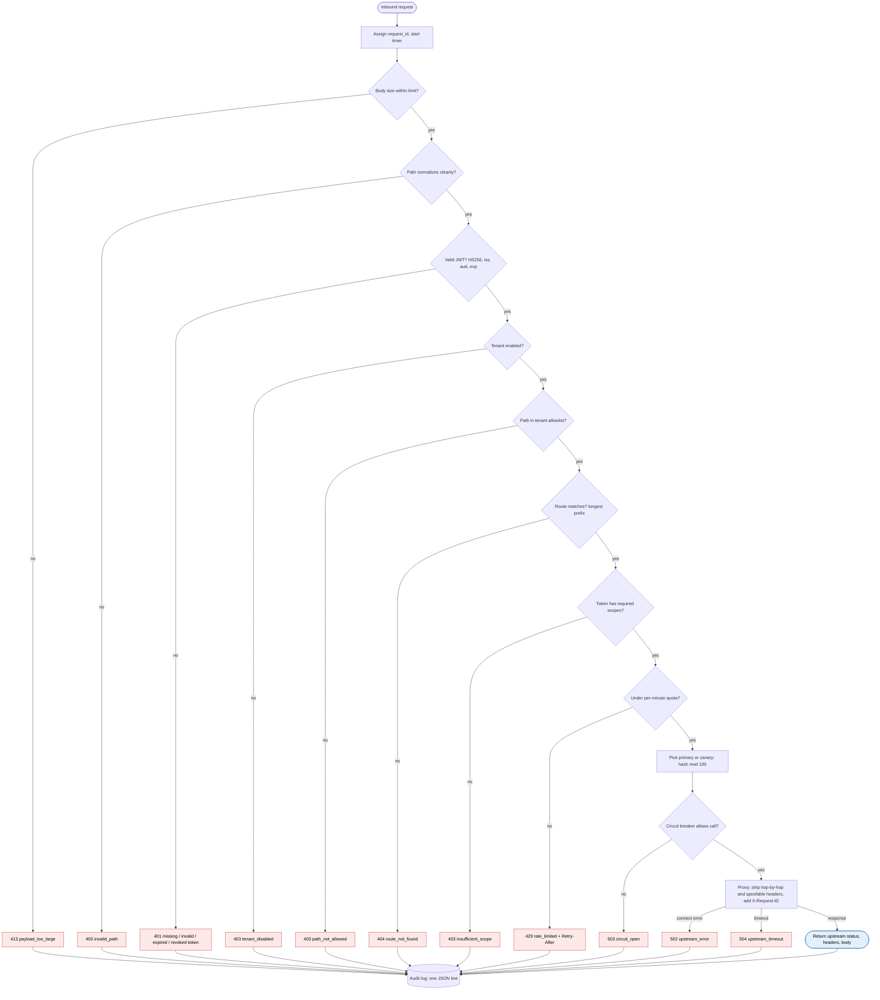

# Architecture flow

A request moves down the main path only while every check passes. Any failed check exits to an error response (red). No red node ever contacts the upstream, except 502/504, which are the upstream call itself failing. Every outcome writes exactly one audit line.

## How to read it

| Node | What happens | Why it is here |
| --- | --- | --- |
| Body size | Reject bodies over `MAX_BODY_BYTES` | Cheapest check; stops memory abuse before any parsing |
| Path normalize | Decode once; reject `..`, `%2e`, `%2f`, `//`, control chars | Every later step must agree on one path, or the allowlist can be bypassed |
| JWT | Pinned HS256, check `iss`, `aud`, `exp`, `jti` denylist | Establishes tenant identity; nothing else may set it |
| Tenant enabled | Look up tenant config | Lets an operator cut off a tenant instantly |
| Allowlist | Segment-boundary prefix match against `allowed_paths` | Before route lookup, so tenants cannot probe which routes exist |
| Route match | Longest prefix on an immutable route-table snapshot | Runtime updates never show a half-applied table |
| Scopes | Route's `required_scopes` ⊆ token `scopes` | Fine-grained permission per route |
| Quota | Sliding-window counter per tenant | Last policy check, so rejected requests never consume quota |
| Canary | Deterministic hash split | Reproducible in tests, no shared state |
| Breaker | Per-upstream closed / open / half-open | Fail fast instead of piling onto a dying upstream |
| Proxy | Shared `httpx.AsyncClient`, strict timeouts, no redirects | Faithful response, bounded resources, no SSRF via redirect |
| Audit | `finally` block writes one structlog JSON line | Every request is accounted for, including crashes |

The circuit breaker state machine is drawn in [GUIDE.md](GUIDE.md#feature-circuit-breaker).
