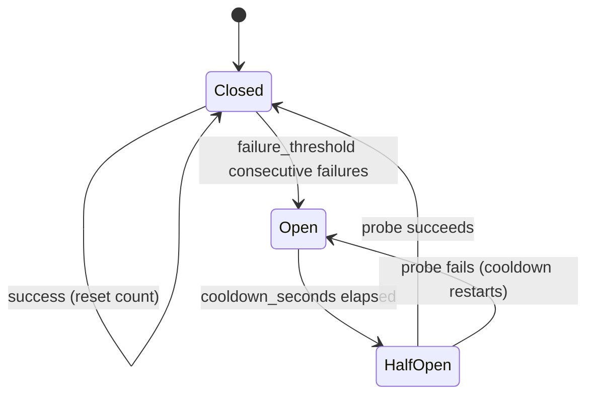

# Multi-Tenant API Gateway: Product & Technical Guide (Part 1)

The gateway is one front door for many customers (tenants). Every request is authenticated, checked against that tenant's rules, forwarded to the right backend service, and recorded. A request that breaks a rule is stopped at the door and never reaches the backend.

The service is a single Python 3.12 process (FastAPI on uvicorn). It runs locally, in Docker, and on DigitalOcean App Platform. Tool choices are explained in [TECH_STACK.md](TECH_STACK.md). The flow diagram is in [ARCHITECTURE.md](ARCHITECTURE.md), the threat model in [THREAT_MODEL.md](THREAT_MODEL.md).

## Glossary

| Term | Meaning in this project |
| --- | --- |
| Tenant | A customer of the gateway. Identified by `tenant_id`, which is the `sub` claim of its token. Each tenant has its own policy. |
| Token | A signed JWT the caller sends as `Authorization: Bearer <token>`. It proves who the tenant is and what scopes it holds. |
| Scope | A permission string inside the token, such as `orders:read`. A route can require one or more scopes. |
| Route | One row in the route table: a path prefix (`/orders`) mapped to an upstream URL, plus required scopes and optional canary settings. |
| Upstream | The backend service a route forwards to, such as `https://api.internal/orders`. |
| Route table | The in-memory list of routes. Admins change it at runtime through `/admin/routes`; no restart needed. |
| Policy | A tenant's rules: which path prefixes it may call (allowlist) and how many requests per minute it may make (quota). |
| Policy decision | The verdict for one request: `allow`, or a `deny` with a reason code such as `path_not_allowed`. Every decision is audited. |
| Audit log | One structured JSON line per request: who, what path, where it went, the decision, the upstream status, and how long it took. |
| Circuit breaker | A per-upstream switch that stops sending traffic to an upstream that keeps failing, then cautiously retries it. |
| Canary | An alternate upstream that receives a set percentage of a tenant's traffic, used to test a new version safely. |
| Admin | The operator of the gateway. Uses a separate admin token to manage routes, tenants and token issuance. Tenants can never act as admin. |

## Request lifecycle walkthrough

The checks run cheapest-first, so a bad request is rejected before it costs anything. This example follows tenant `acme` calling `GET /orders/42`.

1. **Arrive.** The gateway assigns a `request_id` (a UUID), starts a timer, and opens an audit record. The record is written at the end no matter what happens.
2. **Size check.** If `Content-Length` exceeds the limit (default 1 MiB), stop with **413**.
3. **Normalize the path.** Decode it once and reject anything ambiguous: `..`, `%2e`, `%2f`, `//`, or control characters. A bad path stops with **400**. From here on, every step uses this one clean path.
4. **Authenticate.** Read `Authorization: Bearer <jwt>`. Check the signature, the algorithm (`HS256` only), `iss`, `aud`, `exp`. A missing, malformed, expired or forged token stops with **401**. On success the request now carries `tenant_id=acme` and its scopes.
5. **Load the tenant.** Look up `acme`'s policy. An unknown or disabled tenant stops with **403**.
6. **Allowlist.** Is `/orders/42` under one of `acme`'s allowed prefixes? If not, **403** `path_not_allowed`. This runs before route lookup on purpose: a tenant gets the same 403 whether or not a route exists, so it cannot map routes it isn't allowed to use.
7. **Match a route.** Find the longest prefix in the route table that matches on a segment boundary. `/orders` matches `/orders/42` but not `/ordersX`. No match stops with **404**.
8. **Scopes.** Does the token hold every scope the route requires (say `orders:read`)? If not, **403** `insufficient_scope`.
9. **Quota.** Has `acme` used up its requests for the current minute? If so, **429** with a `Retry-After` header. This check is last, so rejected requests never use up quota.
10. **Pick the upstream.** If the route has a canary that applies to `acme`, a hash decides primary or canary.
11. **Circuit breaker.** If that upstream's breaker is open, stop with **503** `circuit_open` without calling it.
12. **Proxy.** Build a clean request: strip hop-by-hop headers, strip the caller's `Authorization` and any spoofed `X-Tenant-*` / `X-Forwarded-*`, then add gateway-owned headers (`X-Request-ID`, `X-Tenant-ID`). Send it with strict timeouts. A connection failure gives **502**; a timeout gives **504**. Otherwise the upstream's status, headers (minus hop-by-hop) and body go back to the caller unchanged.
13. **Record.** The breaker learns whether the call succeeded. The audit line is written with the decision, upstream, status and latency.

Steps 2 to 11 never touch the network. That is what "policy violations must not reach the upstream" means in practice.

## Feature: Authentication & identity

Every proxied request must carry a valid gateway-issued JWT. The token's `sub` claim is the tenant identity used by every later step. Nothing in the URL, query string or headers can override it.

**Behavior**

- The caller sends `Authorization: Bearer <jwt>`. Any other scheme, or no header, is a 401.
- Verification uses PyJWT with `algorithms=["HS256"]` hard-coded. A token whose header says `none`, `RS256` or anything else is rejected before any key is used. This blocks the classic `alg:none` and RS/HS key-confusion attacks.
- Required claims: `iss` (must equal the gateway's issuer), `aud` (must equal `mt-gateway`), `sub`, `exp`, `iat`, `jti`, `scopes`. A missing claim is a 401.
- `exp` is at most 15 minutes after `iat`. A ±30 second leeway absorbs clock drift between machines.
- The header's `kid` selects the signing key. This lets an operator add a new key, issue with it, then retire the old one with no downtime.
- After the signature checks out, the tenant record is loaded. An unknown or `disabled` tenant gets 403 `tenant_disabled`, so an operator can cut off a tenant instantly even while its tokens are unexpired.

**Token issuance**

- `POST /admin/tokens` with an admin token and a body `{"tenant_id": "acme", "scopes": ["orders:read"], "ttl_seconds": 900}` returns a signed JWT.
- Requested scopes must be a subset of the tenant's `max_scopes`, so an admin mistake cannot over-grant. The `admin` scope can never be issued to a tenant.
- A CLI, `uv run gateway-token --tenant acme --scopes orders:read`, does the same thing offline for local testing.

**Edge cases**

| Case | Result |
| --- | --- |
| No `Authorization` header | 401 `missing_token` |
| `Basic ...` or other scheme | 401 `invalid_token` |
| Bad signature, wrong `alg`, unknown `kid` | 401 `invalid_token` |
| Expired (past `exp` + 30 s) | 401 `token_expired` |
| Wrong `iss` or `aud` | 401 `invalid_token` |
| Valid token, tenant disabled or deleted | 403 `tenant_disabled` |
| Token revoked (`jti` on the denylist) | 401 `token_revoked` |

Every 401 includes `WWW-Authenticate: Bearer error="invalid_token"`, as RFC 6750 requires. Error messages are deliberately generic ("token signature invalid"), so an attacker learns nothing about which check failed beyond the code.

**Security notes**

- The signing secret comes from the `GATEWAY_JWT_KEYS` environment variable (a DigitalOcean encrypted secret in production). It is at least 32 random bytes and is never logged.
- Tokens are never written to the audit log. Only `tenant_id` and `jti` are.

## Feature: Dynamic routing

The route table maps path prefixes to upstream URLs and can change while the gateway is serving traffic. In-flight requests always see one consistent version of the table.

**Matching**

- Longest prefix wins, compared segment by segment. With routes `/orders` and `/orders/admin`, the path `/orders/admin/7` goes to `/orders/admin`.
- Segment boundaries matter: `/orders` matches `/orders` and `/orders/42` but not `/ordersX`. A naive `startswith` would get this wrong.
- The matched prefix is stripped by default (`strip_prefix: true`). `/orders/42` with upstream `https://orders.svc/v1` becomes `https://orders.svc/v1/42`. The query string is passed through unchanged.

**Runtime updates without restart**

- The table is an immutable snapshot (a tuple of frozen route objects, pre-sorted by prefix length).
- An admin write takes an `asyncio.Lock`, builds a brand-new snapshot, validates it, then swaps one reference. Readers never take the lock; each request grabs the current reference once at the start and uses it to the end.
- In Python, assigning one reference is atomic, so a reader sees either the old table or the new one, never half of each. This is called copy-on-write.
- **Seed file:** on startup the gateway loads `config/routes.json`, which is committed to the repo. That file is the durable source of truth, and a deploy always starts from it.
- **Runtime changes live in memory.** App Platform's container filesystem is wiped on every deploy or restart, so writing changes to a local file would silently lose them. Admin API changes take effect instantly and last until the next restart; to make one permanent, commit it to `config/routes.json`. `GET /admin/routes/export` returns the current table in that file's format. Durable runtime changes would need DigitalOcean Managed Redis or Postgres (see Known gaps).

**Admin API** (requires an admin token; tenant tokens get 403)

| Method and path | Effect | Errors |
| --- | --- | --- |
| `GET /admin/routes` | List all routes | |
| `PUT /admin/routes/{route_id}` | Create or replace a route | 422 invalid body or unsafe upstream |
| `DELETE /admin/routes/{route_id}` | Remove a route | 404 unknown route |
| `GET /admin/routes/export` | Current table in `config/routes.json` format, ready to commit | |
| `GET /admin/tenants`, `PUT /admin/tenants/{tenant_id}` | List tenants; create, change or disable one | 422 invalid body |
| `POST /admin/tokens`, `POST /admin/tokens/revoke` | Issue a tenant token; revoke one by `jti` | 422 unknown tenant or over-grant |
| `GET /admin/upstreams` | Circuit-breaker state per upstream | |

Interactive API docs for these endpoints are served at `/admin/docs`. Route prefixes may not be `/` or overlap the gateway's own paths (`/admin`, `/healthz`).

Each upstream URL is validated on write: `http` or `https` only, no credentials in the URL, and the host must not resolve to a private, loopback, link-local or cloud-metadata address. See the SSRF threat in [THREAT_MODEL.md](THREAT_MODEL.md).

**Faithful proxying**

- The upstream's status code, body and headers are returned as-is, except hop-by-hop headers (`Connection`, `Keep-Alive`, `Transfer-Encoding`, `TE`, `Trailer`, `Upgrade`, `Proxy-*`).
- Response bodies are streamed back, so a large download does not sit in gateway memory.
- Redirects from the upstream (3xx) are returned to the caller as-is, never followed by the gateway.
- A 4xx or 5xx from the upstream is passed through faithfully. It is not a gateway error and is not reformatted.

## Feature: Policy enforcement

Three per-tenant checks run before any upstream call: path allowlist, required scopes, and a per-minute quota. A failure returns a descriptive error and the request never leaves the gateway.

| Order | Check | Passes when | Fails with |
| --- | --- | --- | --- |
| 1 | Path allowlist | The normalized path is under one of the tenant's `allowed_paths` prefixes (segment-boundary match) | 403 `path_not_allowed` |
| 2 | Required scopes | The token's `scopes` contain every scope in the route's `required_scopes` | 403 `insufficient_scope` (message names the missing scope) |
| 3 | Quota | The tenant's estimated requests in the last 60 s is below `rate_limit_per_minute` | 429 `rate_limited` + `Retry-After` |

The quota is checked last so that requests rejected for other reasons do not count against it. Otherwise a misconfigured client could exhaust its own quota with requests that were never going to succeed.

**Quota algorithm: sliding-window counter**

The gateway keeps two counters per tenant: requests in the current clock minute and in the previous one. It estimates the last 60 seconds by weighting the previous minute by how much of it still overlaps the window:

```
estimate = prev × (1 − elapsed_seconds / 60) + curr
```

Example: limit 100, previous minute had 80, current minute has 30, and we are 15 s in. Estimate = 80 × 0.75 + 30 = 90, so the request is allowed. A plain fixed window would reset to zero at :00 and allow up to 200 requests in two seconds around the boundary; this method caps that burst.

- Memory is two integers per tenant, regardless of traffic.
- Check-and-increment happens with no `await` in between. Under asyncio's single thread that makes it atomic, so concurrent requests cannot both squeeze through the last slot.
- `Retry-After` is the number of whole seconds until the estimate falls below the limit, at least 1.
- Response headers on every proxied request: `X-RateLimit-Limit`, `X-RateLimit-Remaining`.

**Edge cases**

- `rate_limit_per_minute: 0` blocks the tenant entirely (every request 429).
- An empty `allowed_paths` list allows nothing. There is no implicit "allow all"; `/` must be listed explicitly.
- A route with no `required_scopes` needs only a valid token.
- Counters live in process memory. They reset on restart and are not shared across instances (see Known gaps in [THREAT_MODEL.md](THREAT_MODEL.md)).

## Feature: Audit log

Every inbound request produces exactly one JSON line on stdout, including requests rejected at the size check. The line is written from a `finally` block, so even an unexpected exception is recorded (as status 500, `decision: "error"`).

```json
{"ts":"2026-11-16T14:03:22.418Z","event":"request","request_id":"7f3c...","tenant_id":"acme","jti":"b91e...","method":"GET","path":"/orders/42","route_id":"orders","upstream":"https://orders.svc/v1","canary":false,"decision":"allow","reason":null,"upstream_status":200,"status":200,"latency_ms":41.7,"client_ip":"203.0.113.9"}
```

| Field | Meaning | When empty |
| --- | --- | --- |
| `tenant_id` | Resolved tenant (from the verified token) | `null` before auth succeeds |
| `path` | The normalized path, or the raw path truncated to 512 characters if normalization failed | never |
| `upstream` | Base URL of the upstream chosen (primary or canary) | `null` if rejected before routing |
| `decision` | `allow` (the upstream answered, whatever its status), `deny` (the gateway refused: 4xx or 503 `circuit_open`), `error` (502, 504 or a gateway bug) | never |
| `reason` | Machine code such as `rate_limited`, `circuit_open` | `null` on allow |
| `upstream_status` | Status the upstream returned | `null` if never called, or on 502/504 |
| `status` | Status the gateway returned to the caller | never |
| `latency_ms` | Wall time inside the gateway until the response headers are ready (the body then streams) | never |

**Never logged:** the `Authorization` header or any token, request or response bodies, query strings (they often carry secrets), or cookies.

**Why stdout:** containers and DigitalOcean App Platform collect stdout automatically. Shipping to a log store or SIEM is then a platform setting, not application code. Admin actions (route and token changes) are logged the same way with `event: "admin"`, the admin's `sub`, and what changed.

## Feature: Circuit breaker

Each upstream URL has its own breaker. When an upstream keeps failing, the gateway stops calling it for a cooldown period and answers 503 immediately. That protects the struggling upstream and keeps callers from waiting on timeouts.



| From | Event | To |
| --- | --- | --- |
| Closed (normal) | A call succeeds | Closed, failure count reset to 0 |
| Closed | `failure_threshold` consecutive failures (default 5) | Open |
| Open | A request arrives before `cooldown_seconds` (default 30) have passed | Open; the request gets 503 `circuit_open` |
| Open | Cooldown has passed | Half-open |
| Half-open | Up to `half_open_max_probes` requests (default 1) are let through; others get 503 | Half-open |
| Half-open | A probe succeeds | Closed |
| Half-open | A probe fails | Open, cooldown restarts |

**What counts as a failure:** a connection error, a timeout, or an upstream 5xx. An upstream 4xx is the caller's fault, so it counts as a success for breaker purposes. Policy rejections never touch the breaker because they never reach the upstream.

**Config:** the three numbers are set per route (`circuit_breaker: {failure_threshold, cooldown_seconds, half_open_max_probes}`), with global defaults from environment variables.

**Edge cases**

- Breakers are keyed by upstream URL, not route. Two routes sharing an upstream share its health.
- When a probe slot is taken, the next caller gets 503 rather than queueing. Only `half_open_max_probes` requests test the upstream at once.
- The current time comes from `time.monotonic()`, so a wall-clock change cannot open or close a breaker.
- Breaker state is visible at `GET /admin/upstreams` for debugging.

## Feature: Canary routing

A route can send a fixed percentage of requests to an alternate upstream, optionally only for named tenants. This lets an operator try a new backend version on, say, 10% of `acme`'s traffic before switching everyone.

```json
"canary": {"upstream": "https://orders-v2.svc/v1", "percent": 10, "tenants": ["acme"]}
```

- `percent` is an integer from 0 to 100. 0 sends nothing to the canary; 100 sends everything.
- `tenants` is optional. If present, only those tenants are split; everyone else always gets the primary. If absent, all tenants are split.
- The canary upstream passes the same SSRF validation as the primary.

**How a request is assigned:** the gateway computes `bucket = sha256(tenant_id + ":" + request_id) mod 100` and sends the request to the canary when `bucket < percent`. A hash is used instead of `random()` so tests can reproduce an assignment exactly, and so the split is uniform without shared state.

**Interaction with other features**

- Policy checks run before the split, so both upstreams see only allowed traffic.
- The canary has its own circuit breaker. If it opens, those requests get 503 rather than silently falling back to the primary; silent fallback would hide a broken canary.
- The audit line sets `canary: true` and records the canary URL in `upstream`, so error rates per version can be compared from logs.

**Edge case:** splitting is per request, not per user session. One tenant's consecutive requests can land on different versions. Sticky assignment would need a stable client key and is out of scope.

## Feature: Deployment to DigitalOcean

The gateway deploys to DigitalOcean App Platform straight from the GitHub repo, using the same Dockerfile as local Docker runs. One app holds two components: the public gateway and a private demo upstream.

| Component | Built from | Reachable from | Purpose |
| --- | --- | --- | --- |
| `gateway` | `Dockerfile` | The internet, over HTTPS at the app's `ondigitalocean.app` URL | The API gateway |
| `demo-upstream` | The same `Dockerfile`, with `run_command: demo-upstream` | Only inside the app, at `http://demo-upstream:8080` | A tiny echo service to prove routing, canary and breaker behavior |

A third, public upstream (`https://httpbin.org`) is configured as a route too, to show proxying to a real external API.

1. Push to `main` on GitHub. App Platform pulls, builds the Docker images, and rolls out the new version with zero downtime once `/healthz` passes.
2. Secrets (`GATEWAY_JWT_KEYS`, `GATEWAY_ADMIN_KEY`) are set as encrypted `SECRET` environment variables in the app spec. They are never in the repo.
3. App Platform terminates TLS and adds a certificate automatically. The gateway itself listens on plain HTTP port 8080 inside the platform.
4. Logs (including every audit line) appear under the app's Runtime Logs and can be forwarded to a log service.

```bash
./scripts/deploy_do.sh               # create or update the app from .do/app.yaml
doctl apps list
doctl apps logs <app-id> gateway --type run --follow
```

- **One instance only.** Quota counters, the route table and breaker state live in memory, so `instance_count` is 1. Two instances would each enforce the full quota.
- **Internal upstream vs SSRF guard.** `demo-upstream` resolves to a private IP, which the SSRF guard blocks by default. The operator adds it to `UPSTREAM_ALLOWED_PRIVATE_HOSTS=demo-upstream`. That explicit, named exception is the only way to reach a private address.
- **Client IP.** App Platform's load balancer sets the real client IP in a forwarded header. The gateway trusts that header only when `TRUST_PROXY_HEADERS=true`, which is set on DigitalOcean and off locally.

**DigitalOcean fit check.** Every design choice was checked against how App Platform runs containers:

| App Platform behavior | Design consequence |
| --- | --- |
| Builds the Dockerfile itself, on Linux x86-64 servers | Images are never built on the Mac (Apple Silicon, arm64) and pushed, so there is no CPU-architecture mismatch. CI also builds on x86-64 to catch problems early. |
| Sends traffic to the port named in the app spec | The gateway listens on `0.0.0.0:8080`, read from the `PORT` env var with 8080 as default. |
| Container filesystem is wiped on every deploy and restart | No state is written to disk. Routes and tenants are seeded from committed JSON files; logs go to stdout. |
| Restarts or replaces containers that fail health checks | `/healthz` returns 200 with no dependencies, so a slow upstream cannot make the gateway look dead. |
| Stops containers with SIGTERM before replacing them | uvicorn finishes in-flight requests before exiting (graceful shutdown). |
| Can run several instances behind a load balancer | Pinned to `instance_count: 1`, because quotas, breakers and routes are in memory. |
| Terminates HTTPS and forwards to the container over HTTP | TLS needs no code; `TRUST_PROXY_HEADERS=true` lets the gateway read the real client IP. |
| Gives each component a private hostname inside the app | `demo-upstream` is reachable at `http://demo-upstream:8080` and explicitly allowlisted past the SSRF guard. |
| Stores secrets as encrypted env vars | Signing keys come only from env vars, never files in the image. |
| Deploys automatically on push to the connected GitHub branch | CI must pass on GitHub before merging to `main`, so a broken build never ships. |

## Error contract

Every error the gateway itself produces has the same JSON body and an `X-Request-ID` header. Errors that come from the upstream are passed through untouched, so a client can tell them apart by the body shape.

```json
{"error": {"code": "rate_limited", "message": "Tenant 'acme' exceeded 100 requests per minute.", "request_id": "7f3c2a1e-..."}}
```

| Status | `code` | When | Reaches upstream? |
| --- | --- | --- | --- |
| 400 | `invalid_path` | Path contains `..`, encoded `/` or `.`, `//`, or control characters | No |
| 401 | `missing_token` | No `Authorization: Bearer` header | No |
| 401 | `invalid_token` | Bad signature, wrong algorithm, wrong `iss`/`aud`, unknown `kid`, missing claim | No |
| 401 | `token_expired` | Past `exp` plus 30 s leeway | No |
| 401 | `token_revoked` | `jti` is on the denylist | No |
| 403 | `tenant_disabled` | Tenant unknown or disabled | No |
| 403 | `path_not_allowed` | Path is outside the tenant's allowlist | No |
| 403 | `insufficient_scope` | Token lacks a scope the route requires | No |
| 403 | `admin_required` | Non-admin token on `/admin/*` | No |
| 404 | `route_not_found` | Allowed path, but no route matches | No |
| 413 | `payload_too_large` | Body exceeds `MAX_BODY_BYTES` (default 1 MiB) | No |
| 422 | `validation_error` | Admin API body is invalid, or upstream URL is unsafe | No |
| 429 | `rate_limited` | Tenant quota exhausted; includes `Retry-After` | No |
| 502 | `upstream_error` | Could not connect to upstream, or it sent an invalid response | Attempted |
| 503 | `circuit_open` | The upstream's breaker is open, or no half-open probe slot is free; includes `Retry-After` | No |
| 504 | `upstream_timeout` | Upstream did not answer within the timeout (default 10 s read) | Yes |
| 500 | `internal_error` | Unexpected gateway bug; details go to the log only | Maybe |

`message` is for humans and may change. Clients should branch on `code`.

## Data models

Three shapes carry all the state. Each is a pydantic model, so invalid data is rejected at the edge with a 422.

**Tenant config** (loaded from `config/tenants.json`)

```json
{
  "tenant_id": "acme",
  "enabled": true,
  "allowed_paths": ["/orders", "/echo"],
  "rate_limit_per_minute": 100,
  "max_scopes": ["orders:read", "orders:write", "echo:read"]
}
```

- `tenant_id`: 1 to 64 characters, `[a-z0-9-]` only, so it is safe in logs and headers.
- `allowed_paths`: normalized prefixes. Each must start with `/`.
- `max_scopes`: the most a token for this tenant can ever carry.

**Route entry** (seeded from `config/routes.json`, managed at runtime through `/admin/routes`)

```json
{
  "route_id": "orders",
  "prefix": "/orders",
  "upstream": "https://orders.svc/v1",
  "strip_prefix": true,
  "required_scopes": ["orders:read"],
  "timeout_seconds": 10,
  "circuit_breaker": {"failure_threshold": 5, "cooldown_seconds": 30, "half_open_max_probes": 1},
  "canary": {"upstream": "https://orders-v2.svc/v1", "percent": 10, "tenants": ["acme"]}
}
```

- `prefix` must be unique across routes.
- `upstream` and `canary.upstream` pass SSRF validation on write.
- `timeout_seconds` is capped at 30, so a route cannot be set to hang connections.

**Token claims** (JWT header, then payload)

```json
{"alg": "HS256", "typ": "JWT", "kid": "2026-11"}
```

```json
{
  "iss": "mt-gateway",
  "aud": "mt-gateway",
  "sub": "acme",
  "scopes": ["orders:read"],
  "iat": 1795359000,
  "exp": 1795359900,
  "jti": "b91e4c0e-..."
}
```

Admin tokens use the same format with `sub` set to the operator's name and `scopes: ["admin"]`. They are signed with a separate admin key (`GATEWAY_ADMIN_KEY`), so leaking the tenant signing key does not let anyone mint admin tokens.
